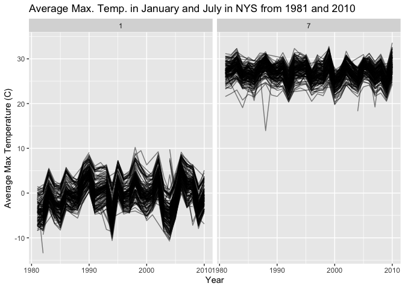

Homework 3
================
Ali Early

# Problem 0

As evidenced throughout this homework.

# Problem 1

``` r
### Load data here and libraries
library(tidyverse)
```

    ## ── Attaching core tidyverse packages ──────────────────────── tidyverse 2.0.0 ──
    ## ✔ dplyr     1.2.1     ✔ readr     2.2.0
    ## ✔ forcats   1.0.1     ✔ stringr   1.6.0
    ## ✔ ggplot2   4.0.3     ✔ tibble    3.3.1
    ## ✔ lubridate 1.9.5     ✔ tidyr     1.3.2
    ## ✔ purrr     1.2.2     
    ## ── Conflicts ────────────────────────────────────────── tidyverse_conflicts() ──
    ## ✖ dplyr::filter() masks stats::filter()
    ## ✖ dplyr::lag()    masks stats::lag()
    ## ℹ Use the conflicted package (<http://conflicted.r-lib.org/>) to force all conflicts to become errors

``` r
library(p8105.datasets)
data("ny_noaa")

### Summary calculations and get data prepared
n_obs = nrow(ny_noaa)
n_cols = ncol(ny_noaa)
n_stations = ny_noaa |> 
  pull(id) |> 
  n_distinct()

### Consider percentages and counts to summarize
total_record_count = nrow(ny_noaa)
total_column_count = ncol(ny_noaa)
total_distinct_stations = ny_noaa |> 
  summarize(n = n_distinct(id)) |> 
  pull(n)

### Missing data percentages (`NA`)
pct_missing_tmax = ny_noaa |> 
  summarize(pct = mean(is.na(tmax)) * 100) |> 
  pull(pct)
pct_missing_tmin = ny_noaa |> 
  summarize(pct = mean(is.na(tmin)) * 100) |> 
  pull(pct)
pct_missing_prcp = ny_noaa |> 
  summarize(pct = mean(is.na(prcp)) * 100) |> 
  pull(pct)
pct_missing_snow = ny_noaa |> 
  summarize(pct = mean(is.na(snow)) * 100) |> 
  pull(pct)
pct_missing_snwd = ny_noaa |> 
  summarize(pct = mean(is.na(snwd)) * 100) |> 
  pull(pct)
```

## Problem 1.1. Short description of the dataset

The `ny_noaa` dataset has weather observations collected from New York
weather stations between 1981 and 2010. There are 2595176 observations
(2,595,176) and 7 variables included: station ID (`id`), observation
date (`date`), precipitation (`prcp`, in tenths of mm), snowfall
(`snow`, in mm), snow depth (`snwd`, in mm), and daily max and min
temperatures (`tmax` and `tmin`, in tenths of degrees C). Missing data
is an issue here because stations sometimes collected a subset of
variables rather than all of the variables. For instance, `tmax` is
missing in 43.7% of observations and `tmin` is missing in 43.7%.

``` r
### Clean variables and convert units for ease
ny_noaa_clean = 
  ny_noaa |> 
  janitor::clean_names() |> 
  separate(date, into = c("year", "month", "day"), 
           sep = "-", convert = TRUE) |> 
  mutate(
    tmax = as.numeric(tmax) / 10,
    tmin = as.numeric(tmin) / 10,
    prcp = prcp / 10
  )

### Find 10 most common snowfall values in NYS
common_snowfall_values = 
  ny_noaa_clean |> 
  janitor::tabyl(snow) |> 
  arrange(desc(n)) |> 
  slice(1:10)
```

## Problem 1.2. The why

I cleaned the variable names using janitor::clean_names(), then
separated the date variable into integer columns for year, month, and
day. Maximum temp. (`tmax`), minimum temp. (`tmin`), and prec. (`prcp`)
were divided by 10 to converted from tenths of units into Celsius (C)
and millimeters (mm). Looking at the 10 most common snowfall values,
`0mm` is by far the most frequent since it doesn’t snow in NYS more than
it is. Missing data, `NA`, is the second most common in the data, which
makes sense because a lot of weather stations don’t collect or report
snowfall especially in the summer, for instance. After `0` and `NA`,
smaller values like 3mm and 5mm in the top ten could be due to
measurement differences across stations because some stations recording
trace amounts or using direct measurements.

``` r
### Calculate the average tmax in January and in July per station and year
jan_jul_df = 
  ny_noaa_clean |> 
  filter(month == 1 | month == 7) |> 
  group_by(id, year, month) |> 
  summarize(mean_tmax = mean(tmax, na.rm = TRUE))
```

    ## `summarise()` has regrouped the output.
    ## ℹ Summaries were computed grouped by id, year, and month.
    ## ℹ Output is grouped by id and year.
    ## ℹ Use `summarise(.groups = "drop_last")` to silence this message.
    ## ℹ Use `summarise(.by = c(id, year, month))` for per-operation grouping
    ##   (`?dplyr::dplyr_by`) instead.

``` r
### Plot January compared to July
ggplot(jan_jul_df, aes(x = year, y = mean_tmax, group = id)) + 
  geom_line(alpha = 0.5) + 
  facet_wrap(~ month) +
  labs(
    title = "Average Max. Temp. in January and July in NYS from 1981 and 2010",
    x = "Year",
    y = "Average Max Temperature (C)"
  )
```

    ## Warning: Removed 5932 rows containing missing values or values outside the scale range
    ## (`geom_line()`).

<!-- -->
